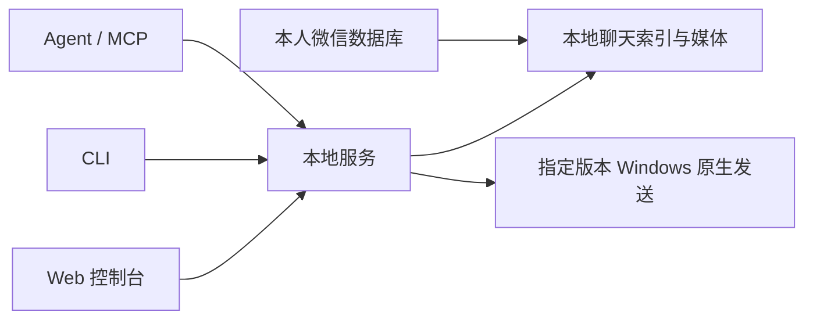

# 微信cli · wechat-cli

个人微信的本地数据工具：一个应用提供 Web 控制台、CLI、HTTP API、MCP 和离线 Skill。

公开预览版 **0.2.0a6**，基于 Windows 基线与 Mac 同事交付包整理。编辑和删除仅影响本地管理副本。

## 功能与平台

- 按昵称、备注、微信号查找联系人与群聊，稳定 ID 定位会话。
- 按日期、关键词检索消息，游标分页、查看缓存图片。
- 导出 JSON、CSV、Markdown 和包含图片、统计图的 Excel。
- 通过 MCP 让 Agent 整理待办、分析上下文、起草回复。
- 在适配的 Windows 微信中向单聊和群聊原生发送文字、图片、文件。

| 能力 | Windows x64 | Mac Apple Silicon |
| --- | --- | --- |
| Web / CLI / MCP、读取、搜索、图片 | 支持 | 支持；原交付方报告真实账号验证 |
| Excel 等格式导出 | 支持 | 支持 |
| CLI / MCP 原生后台发送 | 历史实机版本 4.1.13.65，严格校验客户端 | 未实现 |
| 宿主界面工具发送 | 无需作为原生发送替代 | 原交付方只报告文字验证，须用户允许 |
| Intel Mac | — | 不支持 |

历史账号验证发生在 2026 年 9 月，不代表之后的微信版本兼容。[当前验证范围](CURRENT_STATUS.md)。



## 源码启动

需要 Python 3.12。从完整仓库运行，解析组件保存在 vendor 中。

```sh
git clone https://github.com/minguncle/wechat-cli.git
cd wechat-cli
python -m venv .venv
```

Windows PowerShell：

```powershell
.venv/Scripts/python.exe -m pip install -e '.[dev,windows]'
.venv/Scripts/python.exe boot.py start
```

Mac Apple Silicon：

```sh
.venv/bin/python -m pip install -e '.[dev]'
.venv/bin/python boot.py start
```

访问 `http://127.0.0.1:18765`，按[平台连接说明](docs/platforms.md)配置本人的目录和密钥。源码使用时，将说明中的“启动器”替换为虚拟环境中的 Python 加 `boot.py`。

## Agent 与 MCP

执行 `python boot.py config` 获得当前安装位置对应的 MCP 配置。stdio 入口是 `python boot.py mcp`，常驻 HTTP MCP 地址为 `http://127.0.0.1:18765/mcp`。

示例：“整理这个群今天的待办”“查看刚才的讨论，帮我起草回复”“把这张图片发给已确认的联系人”。发送结果未知时查询原 request_id，不创建新请求重复发送。

## 离线 Skill

[Releases](https://github.com/minguncle/wechat-cli/releases) 中构建完成的 ZIP / tar.gz 包含两个平台的运行组件。将 `wechat-cli` 文件夹放入宿主的 Skill 目录，Windows 使用 `launch.cmd`，Mac 使用 `launch.command`。

GitHub 自动生成的源码归档不包含 Python 运行时，不能当作完整离线包使用。[自行构建](docs/DEVELOPMENT.md)。

## 文档

- [命令说明](docs/commands.md)
- [Excel 导出](docs/excel.md)
- [平台初始化](docs/platforms.md)
- [Mac 界面发送范围](docs/macos-send.md)
- [上游及补丁](docs/UPSTREAMS.md)
- [第三方许可证](THIRD_PARTY_NOTICES.md)

整合代码采用 MIT；第三方源码继续使用各自许可证。模块名和旧配置键仍保留 `novus_wechat` / `novus-wechat`，方便现有用户迁移。
